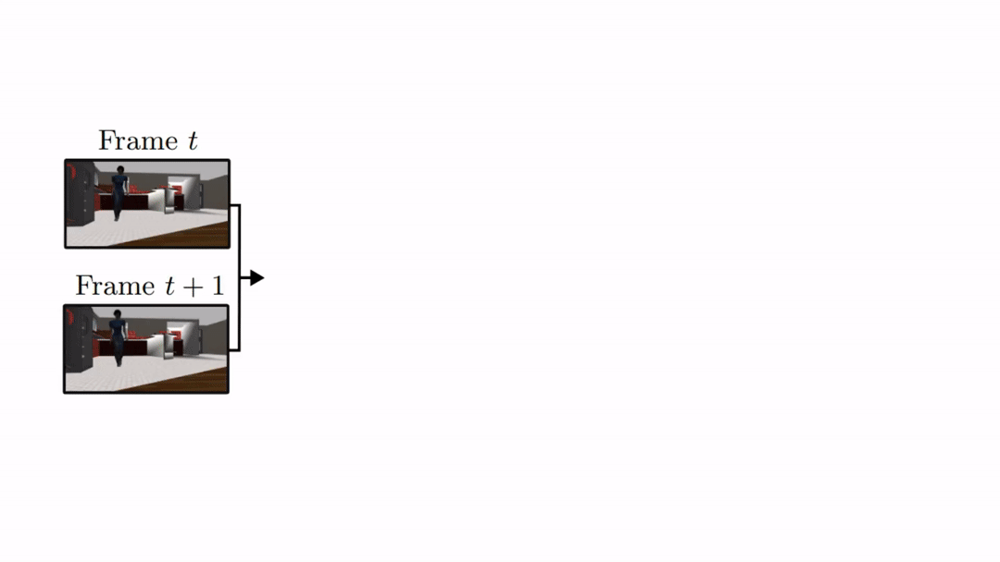
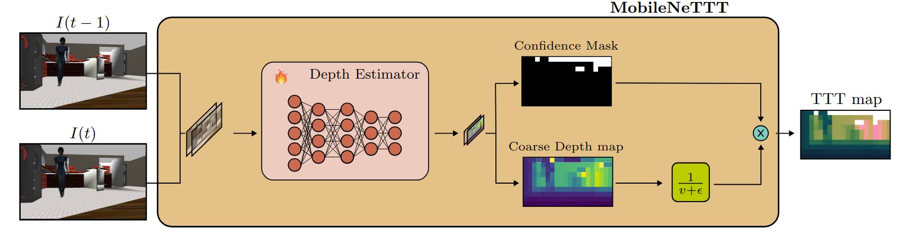
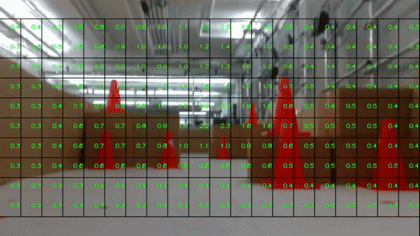
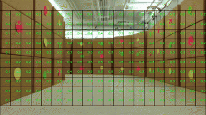
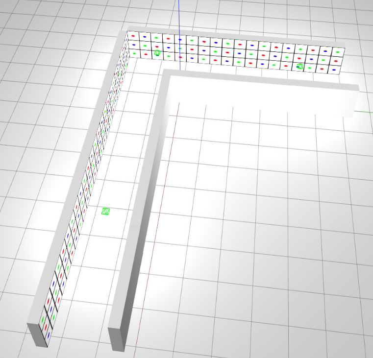
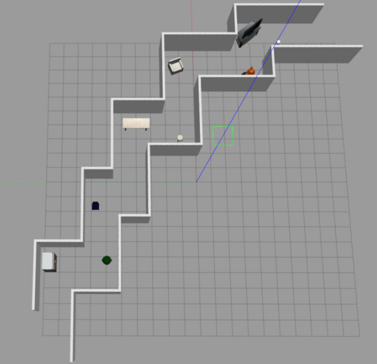
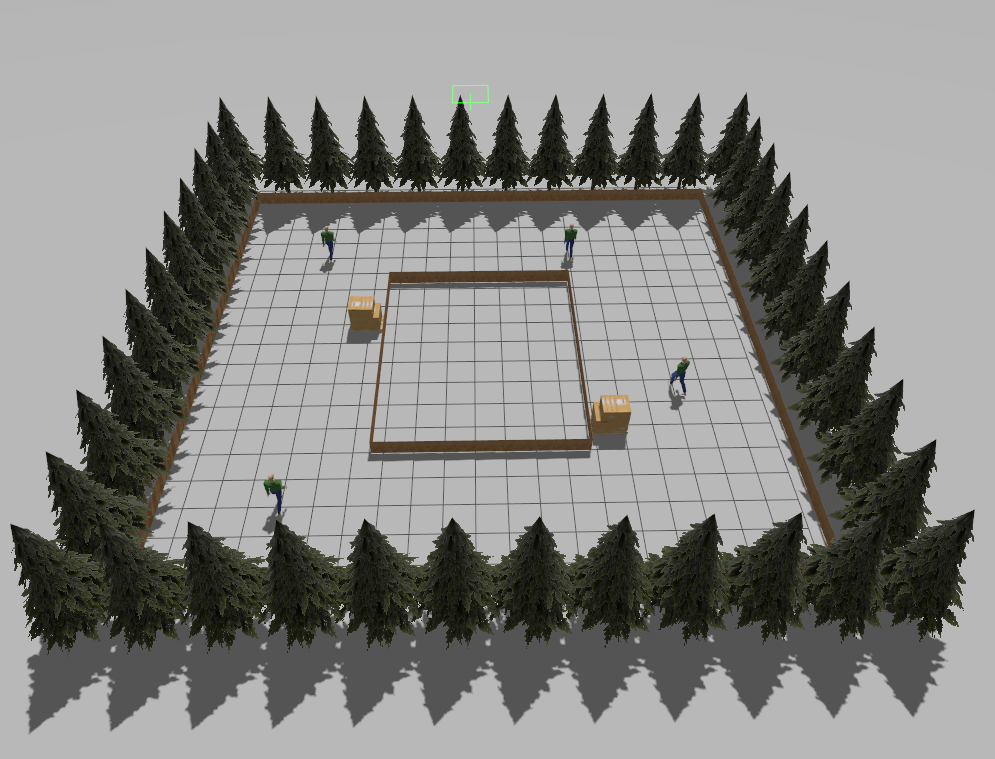
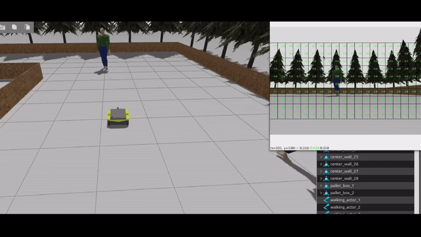
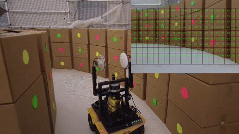

# MobileNeTTT: DNN based Time-To-Transit Estimator for Visual Navigation

[](https://docs.ros.org/en/jazzy/)
[](https://releases.ubuntu.com/24.04/)
<a href="https://arxiv.org"></a>

[](./LICENSE)


Time-to-Transit (TTT) is a perceptual cue believed to be computed in the visual cortex that allows animals to estimate the time remaining to move past features in the environment.  In a previous work, we showed how TTT estimation could be carried out using sparse optical flow based on the classical Lucas-Kanade method.  This proposes an alternative approach to monocular camera navigation in which (1) the useful field of view is larger; (2) the motion of the camera need not be constant along a straight line path; and (3) the steering automatically adjusts to changes in the geometry of observed features--thereby allowing a camera equipped robot to autonomously follow curved paths and steer around obstacles.  The proposed steering control is implemented using a lightweight deep neural network estimator that we have named MobileNeTTT. 
 
The  work  takes  inspiration  from a  classic  paper  by  Lee  and  Reddish  (Nature,  1981, https://doi.org/10.1038/293293a0) in which they outline a behavioral strategy pursued by diving sea birds based on a visual cue called time-to-contact. 

The main code is represented by 2 nodes: the `/nodes/compute_ttt.py` is  responsible  for  the TTT estimation.  It  acquires  a  sequence  of  images  from the  camera  mounted  on  the  robot  and  it  extracts the  relevant  features  to  finally  compute  the  OF vectors. The `/nodes/controller_dynamic.py` organizes the TTT values into a 10x20 grid structure where dynamic regions are introduce. For full details see our Conference202x paper, available on [arXiv](https://arxiv.org/abs/2111.09669).

<div align="center">
    <h4>Past and Current Architecture</h4>
    

</div>


<!--Use 480fps find a way such that we can make gifs not so heavy and easy diagrams, currently 480p cropped out gif-->

##  License and attribution

If you use the code in this repository, please cite [our paper](https://arxiv.org/abs/2111.09669). The code is available under the [BSD-2-Clause License](./LICENSE).

```bibtex
@inproceedings{bbzbaillieul2021,
      title={Visual Navigation Using Sparse Optical Flow and Time-to-Transit},
      author={Boretti, Chiara and Bich, Philippe and Zhang, Yanyu and Baillieul, John},
      booktitle={IEEE International Conference on Robotics and Automation},
      year={2022}
}
```
## Prerequisites
- Python 3.12
- PyTorch with CUDA
- torchvision
- Custom `cbam.py` module (Provided in repo)
- Ubuntu 24.04.
- ROS2 Jazzy (EOL 2029) and Gazebo Harmonic
- ROS-2 Control `sudo apt install ros-jazzy-ros2-control ros-jazzy-ros2-controllers`


> [!Note]
> Dockerfile will be provided soon for ease of use.

## Setup and use

Our navigation strategy can be used with any mobile robot equipped with a monocular camera.

First of all, run `nodes/compute_ttt.py` to compute Time-To-Transit values from a live camera stream. The node subscribes to a camera image topic and processes consecutive frame pairs - cropping each frame to the region of interest (rows 70-340), normalizing and concatenating them into a 6-channel input tensor. This tensor is passed through a MobileNetV3-Small backbone, optinoally enahcne with CBAM attention module (channel+spatial attention), to produce a 2-channel output: predicted TTT values and a confidence map. Cells with confidence below 0.5 are masked out, and the resulting TTT grid is published as a TTTValues.msg for downstream navigation nodes. An optional grid overlay can be displayed in real time for debugging. 

Run the node with: `ros2 run mobilenettt_visionnavigation ttt_values`
<div align="center">
  
</div>


Next Step is to run nodes/controller_dynamic.py to generate velocity commands from the TTT values computed by the previous node. The node analyzes the TTT grid to locate the nearest obstacle and its position relative to the robot, then applies a proportional control law to steer away from it while maintaining forward motion. The resulting TwistStamped message is published to /cmd_vel. Run the node with:

`ros2 run mobilenettt_visionnavigation controller_dynamic`

<div align="center">
  
  
</div>
<sup><sub>Video Speed 7x</sub></sup>

> [!Tip]
> Launch file is included in `/launch/mobilenettt.launch.py` for appropriate gazebo/node/controller manager startup sequence.This launch file could serve as a template for the user for both simulation and the real robot. The following command:

`ros2 launch mobilnettt_visionnavigation mobilnettt.launch.py use_sim:=<boolean value>`

Later on I will provide a concise command sheet to run the simulation and use its functionalities.
Essential parameters for these three nodes are shown below. Other parameters exist and their default values are good for a large amount of environments, but better performances can be achieved by fine-tuning them to adapt the algorithm to the particular environment in which the robot has to move.

### Parameters for `compute_ttt.py`
| Parameter            | Description                                                                                                   |    Example Value  |
| -------------------- | ------------------------------------------------------------------------------------------------------------- | :---------------: |
| ~camera_topic        | Name of the Image topic to subscribe to.                                                                      | "/camera/image"   |
| ~camera_info_topic   | Name of the CameraInfo topic to subscribe to.                                                                 | "/camera_color/camera_info" |
| ~ttt_topic           | Name of the topic to publish TTT values to.                                                                   | "/ttt_values"     |
| ~velocity            | Forward velocity of the robot used to normalize TTT values in the grid display.                               |       0.9         |
| ~attention           | Enables CBAM attention module in the MobileNetV3 backbone.                                                    |       True        |
| ~spatial_att_modified| Enables spatial attention within the CBAM module.                                                             |       False       |
| ~plot_grid           | Enables real-time TTT grid overlay on the camera image.                                                       |       True        |
| ~crop_params         | Pixel rows and columns used to crop the input image before inference (top, left, height, width).              | (70, 0, 340, 640) |

### Parameters for `controller_dynamic.py`
| Parameter            | Description                                                                                                   |    Example Value  |
| -------------------- | ------------------------------------------------------------------------------------------------------------- | :---------------: |
| ~camera_topic        | Name of the Image topic to subscribe to.                                                                      | "/camera/image"   |
| ~camera_info_topic   | Name of the CameraInfo topic to subscribe to.                                                                 | "/camera_color/camera_info" |
| ~ttt_topic           | Name of the TTT values topic to subscribe to.                                                                 | "/ttt_values"     |
| ~velocity_topic      | Name of the topic to publish velocity commands to.                                                            | "/cmd_vel"        |
| ~velocity            | Forward speed of the robot.                                                                                   |        5          |
| ~kp_e                | Proportional gain for extreme left/right obstacle regions.                                                    |       0.1         |
| ~kp                  | Proportional gain for center obstacle region.                                                                 |       0.3         |
| ~max_control         | Maximum angular velocity command sent to the robot.                                                           |       1.0         |
| ~x_percent           | Percentage threshold used to identify left/right boundary neighbors of the peak TTT column.                   |        10         |
| ~constant            | Reference TTT value used when only a single-side obstacle is detected.                                        |        6          |
| ~plot_histogram      | Enables real-time TTT histogram overlay on the camera image for debugging.                                    |      False        |Note that it is also possible to tune the duration of the *Sense* and *Act* cycles.

## Virtual environments
To simulate the behavior of the algorithm in artificial and realistic environments, many scenarios are created in Gazebo. In this repository you will find the code to recreate them in the **GazeboWorlds** folder.  

<p align="center">
  
  &nbsp;&nbsp;&nbsp;
  
  &nbsp;&nbsp;&nbsp;
  
</p>


> [!Important]
> In simulation, it is important to include as many distinct features for optimal estimation performance of the trained model


We also developed patterns to be put on the walls with fixed feature density (Bernoulli distributions of features). The pattern can be created using the `Bernoulli_Textures.py` python scripts in which the density of the features can be set manually. Then the new pattern must be added to the Gazebo materials, the *bernoullixM.png* (where x is the percentage indicating the feature density chosen) generated by the python script has to be saved in `/usr/share/gazebo<y>/media/materials/textures` (where y is the Gazebo version). To use the new material in Gazebo, a *bernoullixM.material* file must be created and saved in `/usr/share/gazebo<y>/media/materials/scripts`. An example of *bernoullixM.material* is:
```
material BernoulliMix/<X>
 {
    technique
    {
       pass
        {
          texture_unit
          {
            texture bernoullixM.png
          }
       }  
    }
 }

```
## Demos

**Platform:** Clearpath Jackal UGV

| Component | Specification |
|---|---|
| **CPU** | Intel Core i7-9700 (Coffee Lake, 8 Core) |
| **RAM** | 32GB DDR4-3600 |
| **GPU** | NVIDIA GeForce GTX 1650 Ti, 4GB GDDR6, 896 CUDA Cores |
| **Camera** | Intel RealSense D435 |
<table>
  <tr>
    <td align="center"></td>
    <td align="center"></td>
  </tr>
  <tr>
    <td align="center">Environment with Dynamic agents</td>
    <td align="center">U Shaped Corridor @ BU Robotics Lab</td>
  </tr>
</table>
<sup><sub>Video speeds: 7x and 3x</sub></sup>
<p align="right">
    
  &nbsp;&nbsp;&nbsp;
  
</p>
